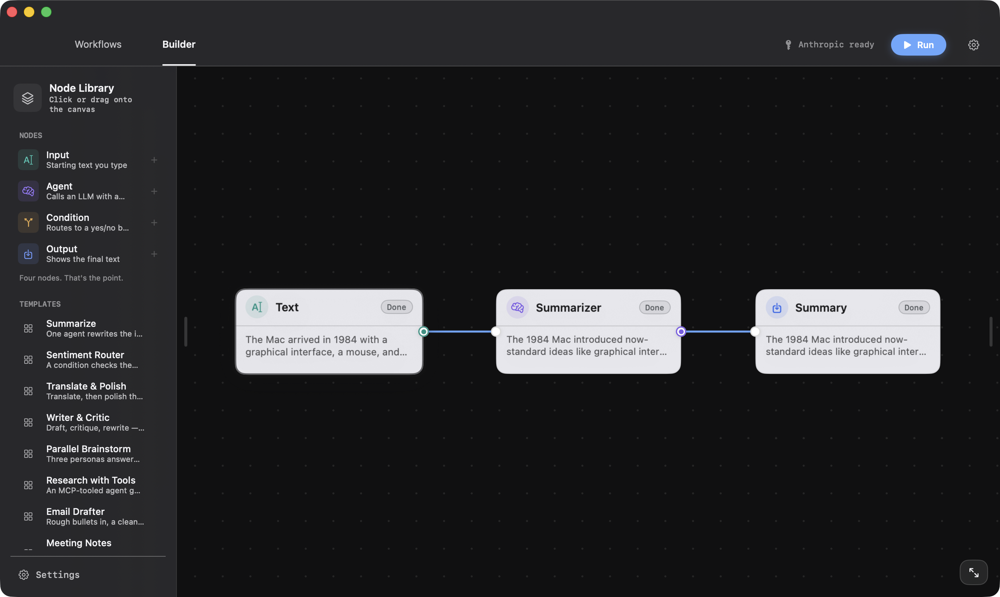
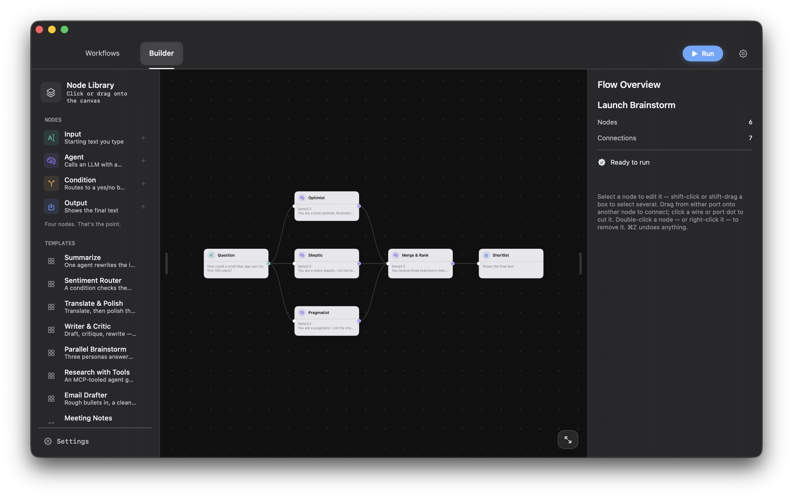
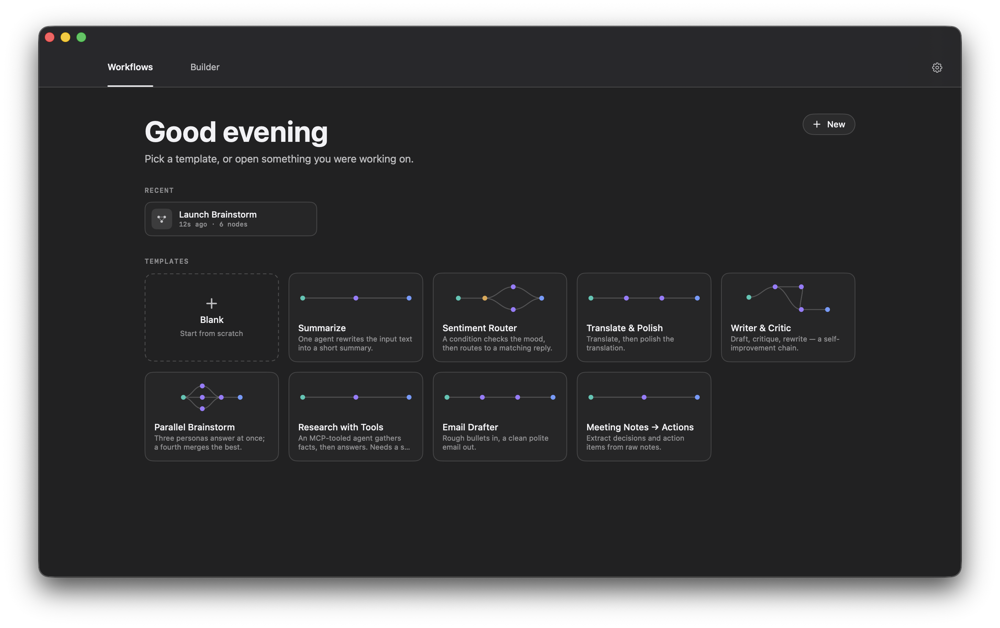

# Osler

Draw the steps once. Osler runs them the same way every time.

Osler is a Mac app for small AI jobs you already know how to do: summarize
this, check that, draft the reply. You lay the steps out as nodes on a canvas,
press Run, and watch every step's output stream in. Next time it runs the same
steps, in the same order, with the model you picked for each one. The models
still write their own words. The recipe doesn't drift.

Claude, GPT and local models through [Ollama](https://ollama.com) can share one
flow. There's nothing to host: no account, no cloud service, no open port, no
telemetry. Your flows are plain files on your Mac.



## Four node types

That's the point. The whole vocabulary is:

- **Input** — the starting text.
- **Agent** — a system prompt and a model. Takes the incoming text, calls the
  LLM, streams text out. Can call MCP tools.
- **Condition** — routes to a `yes` or `no` branch, either by keyword or by
  asking a model a yes/no question.
- **Output** — shows the final text.

Branches that don't depend on each other run **concurrently**, several inputs
can fan into one node (they're joined in edge order), and the branch a
condition didn't take is marked skipped rather than silently dropped.



## Why so few nodes?

Because the vocabulary is small, not the ceiling. An Agent reaches anything
through MCP tools, and `{{Node name}}` reaches any value upstream. Four kinds of
node means you can read a whole flow at a glance.

## Why not just ask Claude?

Ask Claude when you want it to figure things out. Use Osler when you already
know the steps and want them done the same way on Tuesday as on Monday: same
prompts, same order, same checks, and every step's output there to read
afterwards. Each step can use a different model, including one running on your
own Mac.

## Reaching sideways

Text flows along the wires, but a node can also reach a value that isn't wired
into it. Write `{{Node name}}` in an Agent's system prompt (or a Condition's
question) and it's replaced at run time with that node's output:

```
Compare the two.
Original: {{Text}}
Translation: {{Translate}}
```

References may only point *upstream* — at a node that's guaranteed to have
finished first. Anything else is flagged before the flow runs, so a value can
never race its reader. The inspector lists what's in reach.

## Tools, via MCP

An Agent can call tools from [MCP](https://modelcontextprotocol.io) servers —
files, web, APIs, anything with a server. Add one in **Settings → MCP** as a
local command:

```
npx -y @modelcontextprotocol/server-filesystem ~/Documents
```

Hit **Test** to launch it and see its tools, then enable the server on any
Agent node. The agent decides when to call what; each call shows up in the
node's output as it happens.

Today Osler speaks to stdio servers only, and a tool-enabled agent answers turn
by turn instead of streaming live. For now, tool calls run without asking you
first. Asking before each call is next on the [roadmap](ROADMAP.md).

## Models

Bring your own key, or bring your own machine:

| Provider | Needs a key | Notes |
| --- | --- | --- |
| Anthropic | yes | Messages API, streaming |
| OpenAI | yes | Chat Completions, streaming |
| Ollama | **no** | Local models, fully offline |

Keys live in the macOS **Keychain** — never on disk in plain text, never sent
anywhere except the provider you're calling. Ollama needs nothing but a running
server at `localhost:11434`.

## Getting started

**[Download the latest release](https://github.com/albertofettucini/Osler/releases/latest)**
(macOS 14 or newer). Open the `.dmg` and drag Osler to Applications.

The first launch needs one extra step, because Osler isn't signed with a paid
Apple developer account:

1. Open Osler. macOS says it can't verify the app. Click **Done**, not Move to
   Trash.
2. Open **System Settings → Privacy & Security**, scroll down to **Security**,
   and click **Open Anyway** next to Osler. The button only shows for about an
   hour after step 1.
3. Confirm with your password or Touch ID. From then on Osler opens normally.

On macOS 14 you can right-click Osler and choose **Open** instead.

Osler checks for updates by itself. Updates are signed, and Osler won't install
one that doesn't match the project's signing key. After an update, macOS may
ask once whether Osler can use the keys it saved in your Keychain. Click
**Always Allow**.

### Or build it

Requirements: Swift 5.9+ (Xcode 15+).

```sh
git clone https://github.com/albertofettucini/Osler.git
cd Osler
swift run Osler
```

And to produce the app bundle itself:

```sh
./scripts/package-app.sh --desktop     # builds Osler.app and copies it to ~/Desktop
```

Other targets:

```sh
swift test                          # engine + canvas geometry tests
swift run osler-cli --demo linear   # headless run (uses Ollama when no key is set)
swift run osler-cli --demo tools    # MCP tool loop against a mock server
swift run osler-cli --demo cycle    # cycle detection, no model needed
```

## Around the canvas

Eight starter templates ship with the app — Summarize, Sentiment Router,
Translate & Polish, Writer & Critic, Parallel Brainstorm, Research with Tools,
Email Drafter, Meeting Notes → Actions. Open one, press Run, take it apart.



Wiring is two-way: drag from either port onto another node to connect, click a
wire (or a port dot) to cut it. Double-click empty canvas to add a node where
you clicked, or drag one in from the library. Shift-click and shift-drag select
several nodes; ⌘Z undoes anything. ⌘K opens a command palette. Save any flow as
a template and it joins the library.

Flows are plain JSON files (`.oslerflow`) — readable, diffable, and yours. A
flow saved by a newer version keeps its unknown nodes intact when an older
build opens it.

Appearance follows the system, or you can pin light/dark and pick a background
wash and card tint in Settings.

## Architecture

**`OslerEngine`** is a headless Swift library with no UI dependency:

- `FlowGraph` / `Node` / `Edge` — the Codable graph model.
- `GraphValidator` — structural checks and topological ordering, with real
  cycle errors instead of hangs.
- `FlowEngine` — readiness-based scheduling (independent branches run in
  parallel), per-node state as an async event stream, cancellation throughout.
- `LLMProvider` — stream text, or take one tool-calling turn; a provider can
  also say when an answer was cut off (a default covers it). Adding a provider
  is a single type.
- `MCPClient` / `MCPToolbox` — stdio JSON-RPC, tool discovery, call routing.

**`Osler`** is the SwiftUI app — canvas, inspector, run controller — bound to
the engine's event stream. **`osler-cli`** runs flows headlessly.

`swift test` runs 102 engine tests, including a real subprocess round-trip
against a scripted MCP server.

## License

MIT — see [LICENSE](LICENSE).
